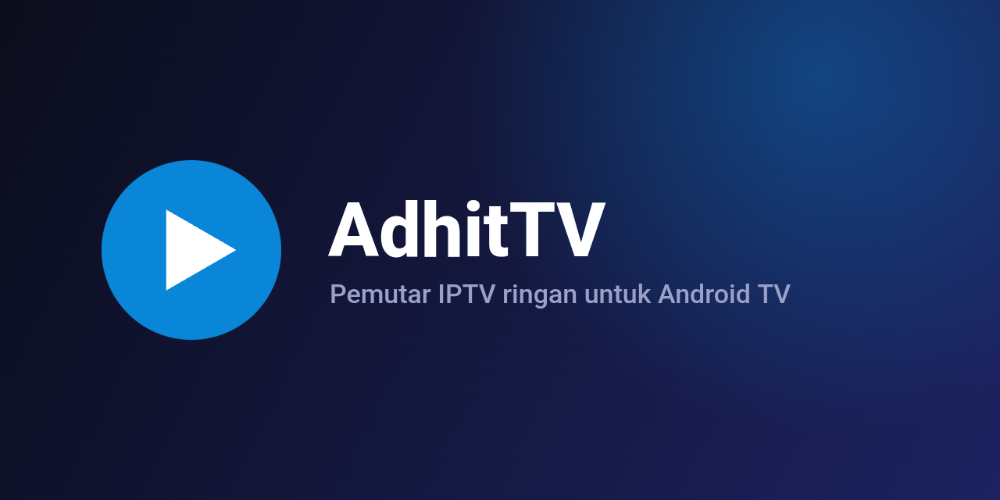

<!-- Dibuat otomatis oleh panel admin (Pembuat APK). Perubahan manual akan tertimpa saat APK dibangun lagi. -->
<p align="center">
  
</p>

<h1 align="center">AdhitTV</h1>

<p align="center">
  Pemutar IPTV ringan untuk <b>Android TV</b>, HP, dan browser.<br>
  Satu server di rumah, tampil di semua layar.
</p>

<p align="center">
  <a href="https://github.com/Tesjiwa/DhanyTV-Android/actions/workflows/build.yml"></a>
  
  
  <a href="https://github.com/Tesjiwa/DhanyTV-Android/releases/latest"></a>
</p>

<p align="center">
  <a href="https://github.com/Tesjiwa/DhanyTV-Android/releases/latest/download/DhanyTV.apk"><b>⬇️ Unduh APK terbaru</b></a>
</p>

---

## ✨ Fitur

- 📺 **Dibuat untuk remote TV**: navigasi D-pad penuh, layar penuh otomatis setelah saluran diputar beberapa detik, dan konfirmasi sebelum keluar.
- ⚡ **Mulai cepat**: sumber yang terbukti hidup dan tercepat dicoba lebih dulu, dengan sumber cadangan otomatis jika gagal.
- 🩺 **Pengecekan saluran yang sungguhan**: server menguji playlist *dan* segmen videonya. Saluran mati disembunyikan, lalu muncul kembali otomatis saat hidup lagi.
- 🎛️ **Panel admin**: muat playlist M3U, atur tampilan dan tema, cek ulang saluran, bahkan bangun APK sendiri tanpa komputer.
- 🌗 **Tema gelap/terang**, favorit, pencarian, dan grup saluran.
- 📱 **Satu aplikasi untuk banyak layar**: mode mendatar dan tegak, layar "server offline" yang rapi, serta tersambung kembali otomatis.

## 📥 Pemasangan

1. Jalankan server (lihat bagian di bawah).
2. Di TV, buka browser atau aplikasi *Downloader* lalu ketik `http://IP-SERVER:3000/apk`, atau unduh lewat tombol di atas.
3. Izinkan pemasangan dari sumber tidak dikenal, pasang, lalu buka aplikasinya.

> Memperbarui: pasang APK yang baru, langsung menimpa versi lama.

## 🧩 Cara kerja

```text
Playlist M3U ──►  Server (Python)  ──►  Aplikasi Android TV (WebView)
                  • cek saluran         • tampilan & kontrol remote
                  • proxy & header      • splash & layar offline
                  • panel admin
```

## 🚀 Menjalankan server

```bash
python server.py        # lalu buka http://localhost:3000
```

Panel admin ada di `http://IP-SERVER:3000/admin`. Server bisa berjalan di Termux, PC, atau Raspberry Pi.

## 🛠️ Build otomatis

APK dibangun oleh GitHub Actions (`.github/workflows/build.yml`) dan dipicu dari panel admin lewat menu **Pembuat APK**. Hasilnya terbit sebagai rilis `latest`.

## 📁 Struktur proyek

```text
app/                 Proyek Android (WebView)
.github/workflows/   Build & rilis otomatis
docs/                Gambar dokumentasi
```

## ⚖️ Penafian

AdhitTV hanyalah pemutar. Proyek ini **tidak menyertakan, menghosting, atau mendistribusikan** saluran maupun konten apa pun. Playlist yang dimuat sepenuhnya milik dan tanggung jawab pengguna, jadi pastikan kamu berhak mengakses sumbernya.

## 📄 Lisensi

[MIT](LICENSE) © 2026 Tesjiwa
